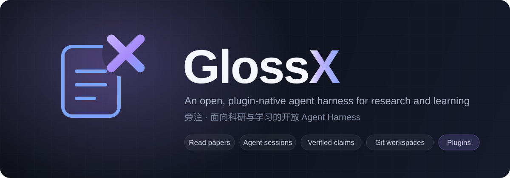
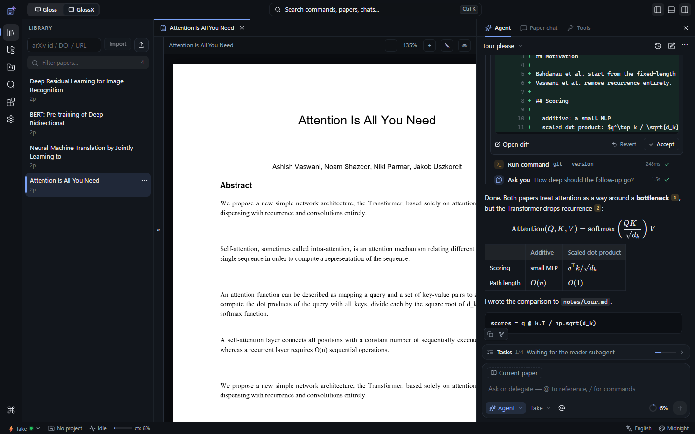
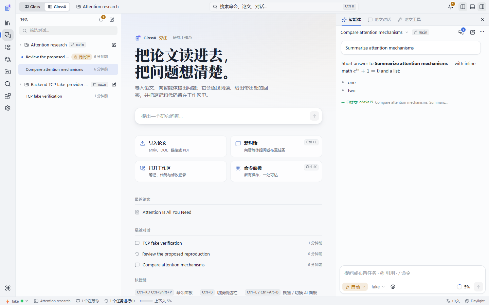
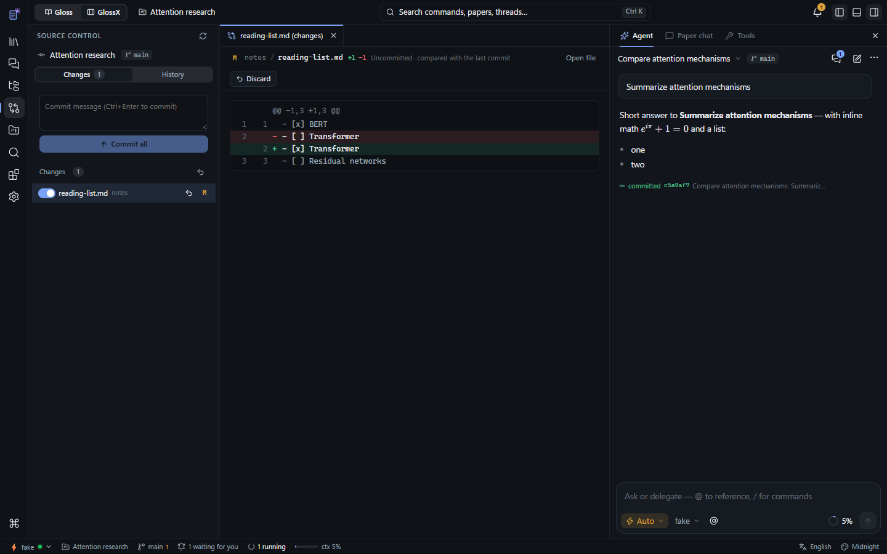
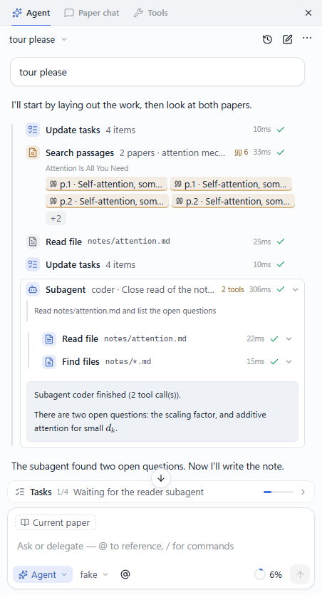
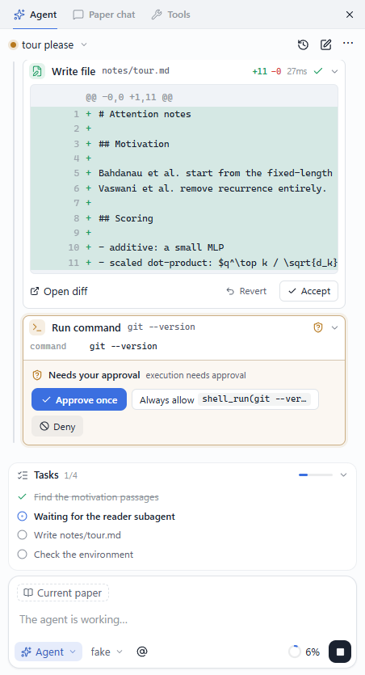
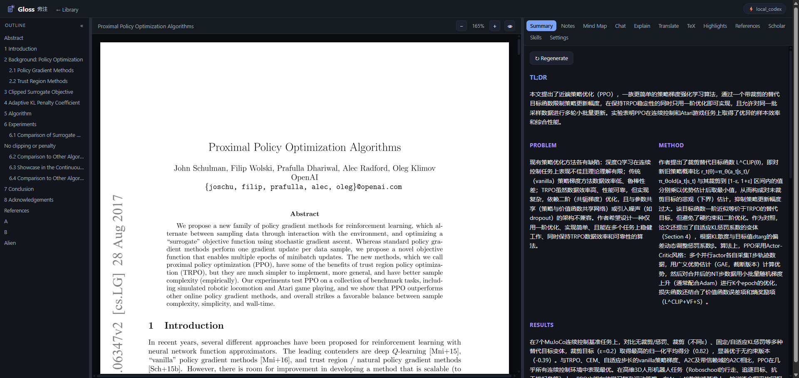
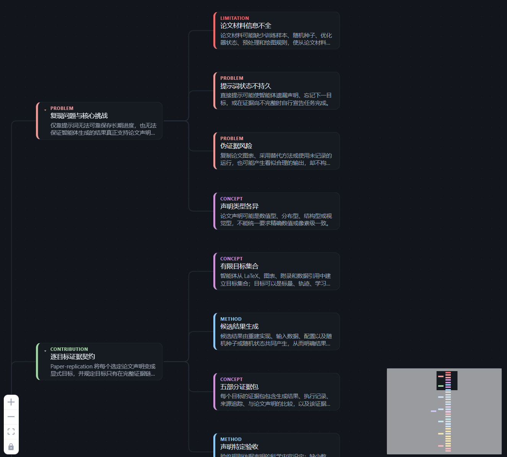
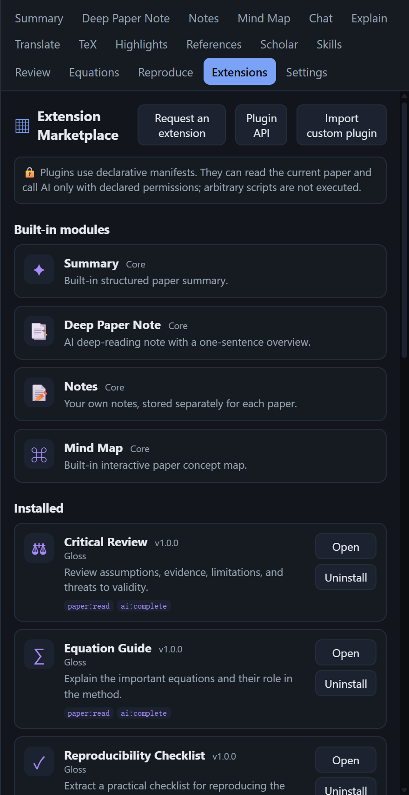

<p align="center">
  
</p>

<p align="center">
  <a href="./README.zh.md"><b>中文</b></a> ·
  <a href="#-quick-start"><b>Quick start</b></a> ·
  <a href="#-features"><b>Features</b></a> ·
  <a href="#-architecture"><b>Architecture</b></a> ·
  <a href="#-documentation"><b>Docs</b></a> ·
  <a href="./CHANGELOG.md"><b>Changelog</b></a>
</p>

<p align="center">
  
  
  
  
  
  
</p>

<br />

**GlossX** is a local, self-hosted workbench in which an AI agent does research *with* you.
Import papers, ask a question, and the agent reads passage by passage, answers with sources you
can click, and leaves its notes and code in a versioned workspace — all on your own machine.

It keeps everything **Gloss** does as a paper reader and adds a full agent harness on top:
long-lived **sessions** in which the model itself decides which tools to call, a Cursor-style
workbench, and a plugin system where tools, commands, subagents, skills, hooks, workflows and
providers are all plugins.

<p align="center">
  
</p>

<table>
  <tr>
    <td width="33%" valign="top">
      <h3>📖 Read</h3>
      A real PDF reader with summaries, notes, mind maps, translation and highlights — every answer points back to the exact passage.
    </td>
    <td width="33%" valign="top">
      <h3>🤖 Delegate</h3>
      Agent sessions that search, read, verify claims, write files and run code, with approvals, plan mode, subagents and a todo list.
    </td>
    <td width="33%" valign="top">
      <h3>🧩 Extend</h3>
      Everything is a plugin: skills, slash commands, hooks, MCP servers, Claude Code / Codex delegates, SSH remotes and workflows.
    </td>
  </tr>
</table>

> [!NOTE]
> **GlossX is under active development** on the `glossX-dev` branch of a private repository.
> There are no public releases and no npm publication yet. Preview builds (`GlossX.exe` for
> Windows and the `glossx-local` npm tarball) come from the GitHub Actions **Preview build**
> workflow artifacts (kept for 14 days); otherwise [run it from source](#-quick-start).
> GlossX is built on **[Gloss](https://github.com/computersniper/gloss)**, whose public releases
> and npm package belong to that upstream project.

## 📸 A quick look

<table>
  <tr>
    <td width="50%" valign="top">
      
      <p align="center"><sub><b>Threads &amp; inbox</b> — sessions grouped by project; the bell lists what needs you first.</sub></p>
    </td>
    <td width="50%" valign="top">
      
      <p align="center"><sub><b>Versioned workspaces</b> — every workspace is a git repo; the agent commits each turn.</sub></p>
    </td>
  </tr>
  <tr>
    <td width="50%" valign="top" align="center">
      
      <p align="center"><sub><b>Subagents</b> — delegated tasks show their own tool calls and result.</sub></p>
    </td>
    <td width="50%" valign="top" align="center">
      
      <p align="center"><sub><b>Approvals</b> — writes and commands ask first: once, always, or deny.</sub></p>
    </td>
  </tr>
</table>

<sub>Screenshots are from real sessions driven by a test model (shown as <code>fake</code> in the composer).</sub>

Models can be your local **Claude Code CLI**, your local **Codex CLI**, the **Anthropic API**, or
**any OpenAI-compatible endpoint**.

## 🔀 Two modes

Switch between them with the toggle at the top left.

| Mode | What it is |
|---|---|
| **Gloss** | The classic local AI paper reader: PDF reader with summary, notes, mind map, chat, translate, explain, highlights, annotations, references, scholar search, library, skills and plugins. |
| **GlossX** | The research workbench: library, multi-tab PDF reader, a session-based agent chat where the model calls tools itself, workspace files with checkpoints, and the full harness described below. |

## ✨ Features

| Feature | What it does |
|---|---|
| **Agent sessions** | Persistent, concurrent chat sessions; list, rename, fork, delete, interrupt. The model decides each turn which tools to call; tool calls render as compact cards with streaming output. |
| **Permission modes** | **Ask** (read-only), **Agent** (writes and execution need approval), **Auto** (auto-approve workspace edits, execution still asks), **Plan** (read-only; ends with a plan you can accept). Allow / ask / deny rules; approve once, always, or deny with feedback. |
| **Tools** | Library and paper tools (search, read sections or pages, span search, summary, explain, references, scholar search, import), workspace file tools, shell and Python execution, web search and fetch, todos, `ask_user`, project memory. |
| **Workspace files and checkpoints** | A sandboxed workspace per project, with an explorer and editor tabs. Every write records a checkpoint so you can view a diff and accept or revert. `GLOSSX.md` project instructions are always injected. |
| **Slash commands and @-mentions** | Built-in `/clear`, `/compact`, `/mode`, `/model`, `/review`, `/summarize`, `/todos`, `/help`, plus custom commands from markdown files. `@` attaches papers, spans, workspace files or runs. |
| **Subagents** | Nested sessions with their own context, tool allowlist and turn budget. Built-in `reader`, `reviewer`, `coder`, `searcher`; define your own in markdown. |
| **Skills** | Claude / Codex `SKILL.md` skills exposed as `skill_<name>` tools with progressive disclosure. |
| **Hooks** | `pre_tool_use`, `post_tool_use`, `session_start` and `stop` shell hooks; a failing pre-tool hook blocks the call. |
| **MCP client and server** | Launch stdio MCP servers and use their tools; GlossX also serves `/mcp` so Claude Code or Codex can use your library. |
| **Claude Code / Codex delegates** | Hand a task to the local `claude` or `codex` CLI, with tools enabled, in a per-run sandbox directory. |
| **SSH remote execution** | Run commands on configured hosts through the system `ssh` binary (key-based auth only). |
| **Literature review with claim verification** | A built-in workflow: plan, search with fallbacks, screen, read with reader subagents, verify claims against paper spans, write a cited report. |
| **Projects and memory** | Research projects with persistent memory notes recalled at plan time; verified claims are saved back. |
| **Context management** | Token meter, auto-compaction at 80% of the context limit, large tool results stored by reference. |
| **Built-in agent browser** | Uses installed Edge/Chrome over CDP with accessibility element refs, browser tabs, a live view and user takeover. Downloads and paper imports require approval; private destinations are blocked by default. |
| **Prompt cache usage** | Provider-reported input, cached and output tokens, session and turn cache indicators, usage history, and incremental Codex/Claude sessions with full-transcript fallback. Missing token counts remain labelled estimates. |
| **Workspace locations** | Choose a default folder for new paper workspaces or move one existing workspace explicitly. GlossX verifies copied files, Git history and checkpoints before switching, and preserves the original directory. |
| **Plugins (manifest v2)** | Kinds: `tool`, `command`, `agent`, `skill`, `hook`, `mcp`, `workflow`, `loop`, `decider`, `provider`, `view`. Third-party manifests are declarative only; tool output is always treated as untrusted data. |

Plugin authors: see the [Gloss Plugin Authoring specification](docs/plugin-authoring.md).

Browser/cache specification and implementation notes: [spec](docs/glossx-browser-cache.md),
[progress](docs/progress/browser-cache-integration.md). Settings suggest current Codex models including
`gpt-6.1-sol`; availability depends on your account and endpoint. Custom model IDs remain supported.

### Threads, paper workspaces and version control

The workspace features are specified in [docs/glossx-workspaces.md](./docs/glossx-workspaces.md).

- **Threads and inbox** — sessions grouped under their project, per-thread unread and attention
  state (needs approval, needs answer, finished, failed), a live inbox with an unread badge.
- **A workspace per paper** — adding a paper automatically creates a project and a workspace seeded
  with `GLOSSX.md` and `notes/`; research projects can hold several papers.
- **Git-backed version control** — every workspace is a git repository, with auto-commit at the end
  of a turn, branches, merge, restore, a source-control view, and agent `vcs_*` tools.
  Auto-commit can be disabled in agent settings. When Git is unavailable, file checkpoints
  remain usable. Conflicting merges are aborted and report the affected files.

## 🧱 Architecture

```
kernel          capability registry · scheduler · permission & sandbox gate · budget meter · trace log
plugins         manifest v2 -> adapters: native Python · declarative manifest · Agent Skills ·
                MCP (client + server) · Claude Code / Codex delegates · SSH · LLM providers
harness         sessions · tool-calling loop · modes & permissions · context compaction ·
                commands · subagents · skills · hooks · mentions
workbench       React UI: library · multi-tab PDF reader · session chat · workspace explorer & editor
classic Gloss   reader features: summary · notes · mind map · chat (RAG) · translate · highlights ...
```

- **Kernel** is small and fixed: every capability has a short card, I/O schema, permissions, cost
  hint and trust tier (`first-party`, `third-party`, `external`). Sensitive permissions
  (`code:execute`, `remote:ssh`, `mcp:call`, `library:write`) require approval, and per-run budgets
  stop runaway loops.
- **Harness** runs the model-driven tool loop over any provider and streams events (SSE) to the UI.
- **Workbench** is the Cursor-style front end: the AI pane is a session chat next to the PDF tabs
  and workspace editor.

Design documents: [docs/glossx-design.md](./docs/glossx-design.md),
[docs/glossx-harness.md](./docs/glossx-harness.md).

Repository layout: `backend/` (FastAPI, serves the built SPA), `frontend/` (React + Vite + pdfjs-dist
+ KaTeX + React Flow), `cli/`, `scripts/`, `packaging/`.

## 🚀 Quick start

GlossX is not published yet, so choose one of the following.

### Preview builds

Open the repository's **Actions** tab, pick a run of the **Preview build** workflow, and download an
artifact:

- `GlossX-windows-x64` — the portable Windows app `GlossX.exe` (no install, opens its own window).
- `GlossX-npm-package` — the `glossx-local-*.tgz` npm tarball for Windows, Linux and macOS.
  Install it with `npm install --global ./glossx-local-*.tgz`, then start with `glossx`.

Artifacts expire after 14 days.

### From source

Requires Git, Node.js 20.19+ and Python 3.11+:

```bash
git clone https://github.com/computersniper/glossX.git
cd glossX
git checkout glossX-dev
npm run setup
npm start
# or: bun run setup && bun run start
```

Open `http://localhost:8010`. Use `--port` and `--host` to change the address. The package ships the
bins `glossx` and `glossx-local` (for example `glossx-local --help`, `glossx-local doctor`).

Optional native scripts: `scripts/setup.sh` / `scripts/run.sh` (Linux) and
`.\scripts\setup.ps1` / `.\scripts\run.ps1` (Windows PowerShell).

### Remote Linux over SSH

```bash
# Remote server
glossx-local --host 127.0.0.1 --port 8010

# Local computer
ssh -N -L 8010:127.0.0.1:8010 -p <ssh-port> user@server
```

Then open `http://localhost:8010` locally.

## 🧰 CLI

```bash
./gloss serve                  # Linux/macOS: start the web app
.\gloss.ps1 serve              # Windows PowerShell
./gloss open <pdf|arxiv|doi>   # import + serve + open the browser
./gloss import <src>           # add a local PDF / arXiv / DOI to the library
./gloss ls                     # list the library
./gloss summarize <id|pdf|arxiv>   # print a summary in the terminal
./gloss chat <id>              # interactive terminal chat
./gloss skills                 # list discovered Claude / Codex skills
```

## 🔧 Configuration

### Providers

Pick a provider in **Settings** (the generated `config.json` is stored in the data directory):

| Provider | Notes | Key? |
|---|---|---|
| `local_claude` | **Default.** Calls the local `claude` CLI via your subscription | no key |
| `local_codex` | Calls the local `codex` CLI via your ChatGPT subscription | no key |
| `anthropic` | Anthropic API, or any Anthropic-compatible endpoint | `base_url` + `api_key` |
| `openai` | Official OpenAI **or any OpenAI-compatible endpoint** (local vLLM, a claude proxy, ...) | `base_url` + `api_key` |

Each provider can have its own model (for example `sonnet` / `opus`, a full model id, or blank for the
CLI's default) and reasoning effort (`local_claude`: `low ... max`; `local_codex`: `minimal ... high`).
Answer language and translation target language are configurable too. API keys are masked by the
Settings API and runtime data stays out of version control.

> **Codex note:** with the local Codex provider, if Codex's own default model is rejected for your
> account, set a model your account supports in **Settings**.

### Connections

Under the agent connections settings you can configure:

- **MCP servers** (`name, command, args, env, enabled`), launched over stdio on first use.
- **SSH hosts** (`name, host, user, port, workdir`), key-based authentication only.
- **CLI agents**: enable or disable the Claude Code and Codex delegates.
- **Auto-approve** list for permissions you trust.

A connection status check reports which servers, hosts and CLIs are reachable.

### Permissions, hooks and context

The harness settings hold the default mode, allow / ask / deny rules (a tool name, `tool:*`, or
`shell_run(<prefix>*)`; deny beats ask beats allow), hooks, and the context limit (default 120k
tokens). Reading is allowed by default; file writes ask; execution asks.

### Agent directories

Like Claude Code's `.claude`, agent configuration lives in plain files. Existing instructions,
commands and agents in the data directory are copied to the new home without overwriting files
or deleting the originals.

- **Global home `~/.glossx/`** (override with `GLOSSX_HOME`): `GLOSSX.md` (global instructions),
  `settings.json` (permissions, hooks, context limit, default mode), `commands/*.md` (custom slash
  commands), `agents/*.md` (subagent types) and `skills/`.
- **Per workspace `<workspace>/.glossx/`**: a project `settings.json` (overrides the global one),
  `commands/`, `agents/`, project memory and checkpoints. `GLOSSX.md` at the workspace root holds the
  project instructions.
- Library data (papers, database, sessions) stays in the data directory below.
- Each paper added to the library gets its own project and workspace directory, and every workspace is
  a git repository with auto-commit per agent turn and branches (see
  [docs/glossx-workspaces.md](./docs/glossx-workspaces.md)).

## 📁 Data location

GlossX uses its **own data directory**, separate from Gloss, so it can run next to an installed
Gloss:

- Windows: `%LOCALAPPDATA%\GlossX\data`
- Linux / macOS: `$XDG_DATA_HOME/glossx` (default `~/.local/share/glossx`)
- Override with `GLOSS_DATA_DIR`.

It holds the SQLite library, one folder per paper, `config.json`, sessions, workspaces, projects
and memory. Agent configuration lives in `~/.glossx/` and each workspace's `.glossx/`;
checkpoints live in `.glossx/checkpoints/` and stay out of Git. Your Gloss data is never touched.

## 💡 Notes

- Local `claude` / `codex` use your existing subscription login (no API key).
- Your data stays local; only external lookups (Crossref, arXiv, Semantic Scholar, web search/fetch)
  leave your machine, and they degrade gracefully when offline.
- Generated results (summary, notes, mind map, translation, highlights) are cached and reused.

## 📚 Documentation

- [docs/glossx-design.md](./docs/glossx-design.md) — kernel, plugin manifest v2, adapters, core agent, context, API
- [docs/glossx-harness.md](./docs/glossx-harness.md) — sessions, tool loop, permissions, commands, subagents, hooks, UI
- [docs/glossx-workspaces.md](./docs/glossx-workspaces.md) — threads and inbox, per-paper workspaces, version control
- [docs/plugin-authoring.md](./docs/plugin-authoring.md) — plugin authoring (Gloss)
- [CHANGELOG.md](./CHANGELOG.md)

## 📖 Classic Gloss mode

Screenshots of the classic Gloss reader (the upstream project is
[computersniper/gloss](https://github.com/computersniper/gloss)):

<table>
  <tr>
    <td width="50%" valign="top">
      
    </td>
    <td width="25%" valign="top">
      
    </td>
    <td width="25%" valign="top">
      
    </td>
  </tr>
  <tr>
    <td valign="top"><b>Reader</b><br />A real PDF text layer beside a structured AI brief, with notes, chat and annotations.</td>
    <td valign="top"><b>Mind map</b><br />Explore paper concepts and their connections.</td>
    <td valign="top"><b>Extensions</b><br />Install, open or remove reading modules.</td>
  </tr>
</table>

## 🙏 Acknowledgments

GlossX builds on Gloss, a **local, self-hosted reconstruction of [Moonlight](https://www.themoonlight.io/)**
("an AI colleague for reading research papers"), rebuilt from scratch to run entirely on your own
machine. Its design also draws inspiration from two lovely projects:

- **[Understand-Anything](https://github.com/Egonex-AI/Understand-Anything)** — for the interactive
  node-link **mind map** (React Flow, click-to-focus, collapsible nodes).
- **[DeepPaperNote](https://github.com/917Dhj/DeepPaperNote)** — for the structured, generated
  **study notes**.

Huge thanks to the authors of all three.
