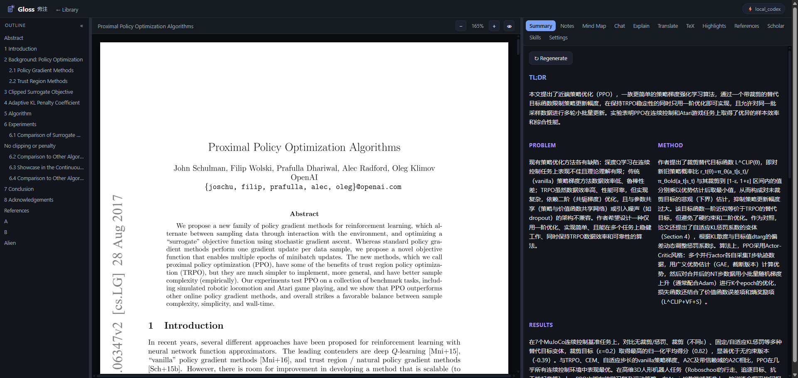
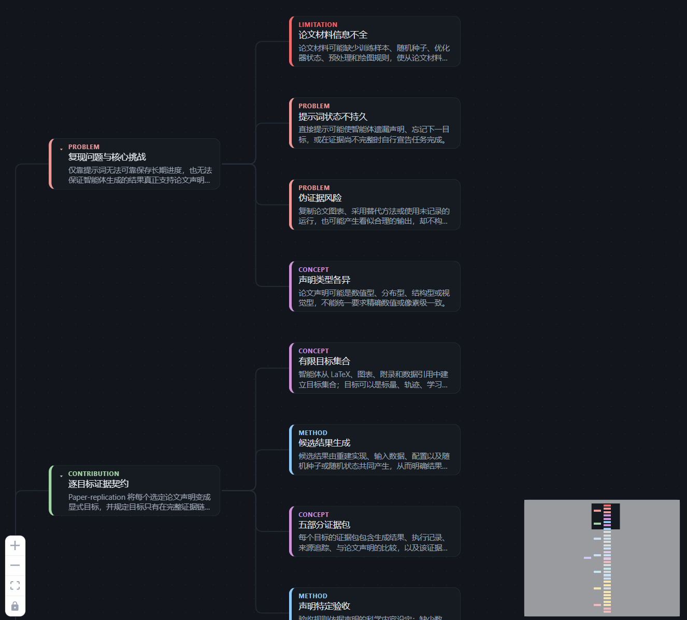
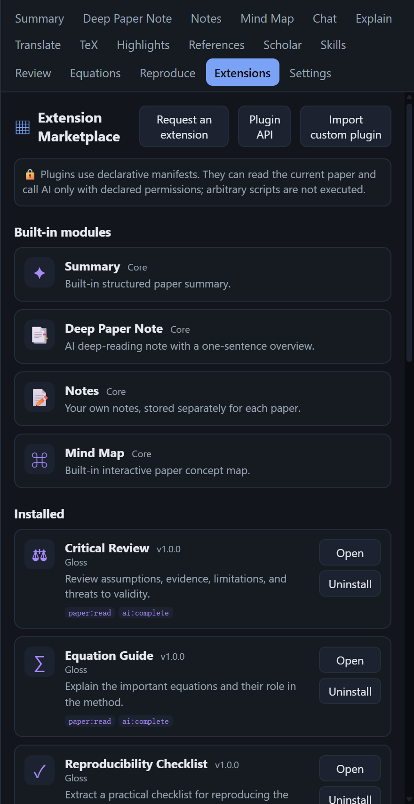

<p align="center">
  
</p>

<h1 align="center">GlossX</h1>

<p align="center"><b>面向科研与学习的开放、插件原生 Agent Harness · 构建于 Gloss 论文阅读器之上</b></p>

<p align="center"><a href="./README.md"><b>English →</b></a> · <a href="./CHANGELOG.md"><b>版本记录</b></a></p>

> **当前状态：积极开发中。** GlossX 位于一个私有仓库的 `glossX-dev` 分支。**目前没有公开发布，
> 也尚未发布到 npm。** 预览版（Windows 的 `GlossX.exe` 与 `glossx-local` npm 压缩包）由 GitHub Actions 的
> **“Preview build”** 工作流构建，可在工作流产物（artifacts）中下载，保留 14 天。在此之前，请
> [从源码运行](#-安装与运行)。
>
> GlossX 构建于本地 AI 论文阅读器 **Gloss** 之上。上游项目是
> [computersniper/gloss](https://github.com/computersniper/gloss)；其公开 Release 与 npm 包属于上游，
> 并不是 GlossX 的发布渠道。

---

GlossX 是一个 **本地、自托管** 的工作台，让 AI Agent 与你一起做研究。它完整保留了 Gloss 作为论文阅读器的
全部能力，并在其上加入完整的 Agent Harness：长生命周期的 Agent **会话**（由模型自己决定调用哪些工具）、
类 Cursor 的工作台（论文库、多标签 PDF 阅读器、工作区文件），以及“一切皆插件”的扩展体系（工具、命令、
子 Agent、技能、钩子、工作流、模型提供方都是插件）。

一切都跑在你自己的机器上。模型可以是本机的 **Claude Code CLI**、本机的 **Codex CLI**、**Anthropic API**，
或 **任意 OpenAI 兼容端点**。

## 两种模式

通过左上角的开关切换。

| 模式 | 说明 |
|---|---|
| **Gloss** | 经典的本地 AI 论文阅读器：PDF 阅读器，配合速览、笔记、思维导图、对话、翻译、解释、高亮、批注、参考文献、学术搜索、论文库、技能与插件。 |
| **GlossX** | 研究工作台：论文库、多标签 PDF 阅读器、由模型自主调用工具的会话式 Agent 对话、带检查点的工作区文件，以及下文介绍的完整 Harness。 |

## 功能一览

| 功能 | 说明 |
|---|---|
| **Agent 会话** | 可持久化、可并发的对话会话，支持列表、重命名、分叉、删除与中断。每一轮由模型自己决定调用哪些工具，工具调用以紧凑卡片呈现并流式输出。 |
| **权限模式** | **Ask**（只读）、**Agent**（写入与执行需要审批）、**Auto**（工作区内的编辑自动通过，执行仍需审批）、**Plan**（只读，最终给出可接受的计划）。支持 allow / ask / deny 规则；可“批准一次”“总是批准”或“拒绝并附反馈”。 |
| **工具** | 论文库与论文工具（检索、按章节或页读取、片段检索、速览、解释、参考文献、学术搜索、导入）、工作区文件工具、Shell 与 Python 执行、网页搜索与抓取、待办、`ask_user`、项目记忆。 |
| **工作区文件与检查点** | 每个项目一个沙箱工作区，带文件浏览器与编辑器标签页。每次写入都会记录检查点，可查看 diff 并接受或回退。工作区根目录的 `GLOSSX.md` 项目说明会始终注入。 |
| **斜杠命令与 @ 提及** | 内置 `/clear`、`/compact`、`/mode`、`/model`、`/review`、`/summarize`、`/todos`、`/help`，也可用 Markdown 文件自定义命令。`@` 可附带论文、片段、工作区文件或运行记录。 |
| **子 Agent** | 拥有独立上下文、工具白名单与轮次预算的嵌套会话。内置 `reader`、`reviewer`、`coder`、`searcher`，也可用 Markdown 自定义。 |
| **技能 Skills** | 将 Claude / Codex 的 `SKILL.md` 技能暴露为 `skill_<name>` 工具，按需渐进加载。 |
| **钩子 Hooks** | 支持 `pre_tool_use`、`post_tool_use`、`session_start`、`stop` 四类 Shell 钩子；`pre_tool_use` 钩子失败会拦截该次调用。 |
| **MCP 客户端与服务端** | 通过 stdio 启动 MCP 服务并使用其工具；GlossX 同时提供 `/mcp` 服务，让 Claude Code 或 Codex 能使用你的论文库。 |
| **Claude Code / Codex 委派** | 把任务交给本机的 `claude` 或 `codex` CLI，在每次运行独立的沙箱目录里启用工具执行。 |
| **SSH 远程执行** | 通过系统 `ssh` 在已配置的主机上运行命令（仅支持密钥认证）。 |
| **带论断核查的文献综述** | 内置工作流：规划、带回退的检索、筛选、用 reader 子 Agent 精读、对照论文片段核查论断、撰写带引用的报告。 |
| **项目与记忆** | 研究项目带有持久记忆笔记，规划时会被召回；核查通过的论断会回写为记忆。 |
| **上下文管理** | Token 计量、达到上下文上限 80% 时自动压缩、大体量工具结果按引用存放。 |
| **插件（manifest v2）** | 类型：`tool`、`command`、`agent`、`skill`、`hook`、`mcp`、`workflow`、`loop`、`decider`、`provider`、`view`。第三方 manifest 仅限声明式；工具输出一律视为不可信数据。 |

插件作者请参阅 [Gloss 插件开发规范](docs/plugin-authoring.zh.md)。

### 开发中

以下功能已写入 [docs/glossx-workspaces.md](./docs/glossx-workspaces.md)，正在实现中，当前构建里可能尚不完整或还没有。

- **线程与收件箱**：会话按项目分组，每个线程有未读与关注状态（需要审批、需要回答、已完成、失败），
  并带有实时更新、显示未读数的收件箱。
- **每篇论文一个工作区**：添加论文时自动创建项目与工作区，并预置 `GLOSSX.md` 与 `notes/`；
  研究项目可包含多篇论文。
- **基于 Git 的版本控制**：每个工作区都是一个 git 仓库，回合结束时自动提交，支持分支、合并、还原、
  源代码管理视图，以及 Agent 的 `vcs_*` 工具。

## 架构简述

```
内核            能力注册表 · 调度器 · 权限与沙箱闸门 · 预算计量 · 追踪日志
插件            manifest v2 -> 适配器：原生 Python · 声明式 manifest · Agent Skills ·
                MCP（客户端 + 服务端）· Claude Code / Codex 委派 · SSH · LLM 提供方
Harness         会话 · 工具调用循环 · 模式与权限 · 上下文压缩 ·
                命令 · 子 Agent · 技能 · 钩子 · 提及
工作台          React 界面：论文库 · 多标签 PDF 阅读器 · 会话对话 · 工作区浏览器与编辑器
经典 Gloss      阅读器功能：速览 · 笔记 · 思维导图 · 对话（RAG）· 翻译 · 高亮 ……
```

- **内核** 小而固定：每个能力都有简短的说明卡、输入输出 schema、权限、成本提示与信任等级
  （`first-party`、`third-party`、`external`）。敏感权限（`code:execute`、`remote:ssh`、`mcp:call`、
  `library:write`）需要审批，每次运行的预算会阻止循环失控。
- **Harness** 在任意 provider 上运行由模型驱动的工具循环，并通过 SSE 把事件流式推送给界面。
- **工作台** 是类 Cursor 的前端：AI 面板是会话对话，与 PDF 标签页和工作区编辑器并排。

设计文档：[docs/glossx-design.md](./docs/glossx-design.md)、
[docs/glossx-harness.md](./docs/glossx-harness.md)。

仓库结构：`backend/`（FastAPI，托管已构建的前端）、`frontend/`（React + Vite + pdfjs-dist + KaTeX +
React Flow）、`cli/`、`scripts/`、`packaging/`。

## 安装与运行

GlossX 尚未公开发布，请选择以下方式之一。

### 预览版

打开仓库的 **Actions** 页，选择一次 **Preview build** 工作流运行，下载其中的产物：

- `GlossX-windows-x64`：便携的 Windows 应用 `GlossX.exe`（免安装，在独立窗口中运行）。
- `GlossX-npm-package`：`glossx-local-*.tgz` npm 压缩包，适用于 Windows、Linux、macOS。
  用 `npm install --global ./glossx-local-*.tgz` 安装，再运行 `glossx` 启动。

产物保留 14 天。

### 从源码运行

需要 Git、Node.js 20.19+ 和 Python 3.11+：

```bash
git clone https://github.com/computersniper/glossX.git
cd glossX
git checkout glossX-dev
npm run setup
npm start
# 或：bun run setup && bun run start
```

打开 `http://localhost:8010`。可用 `--port` 和 `--host` 修改地址。包内提供 `glossx` 与 `glossx-local`
两个命令（例如 `glossx-local --help`、`glossx-local doctor`）。

可选的系统原生脚本：`scripts/setup.sh` / `scripts/run.sh`（Linux），以及
`.\scripts\setup.ps1` / `.\scripts\run.ps1`（Windows PowerShell）。

### 远程 Linux / SSH

```bash
# 远程服务器
glossx-local --host 127.0.0.1 --port 8010

# 本机
ssh -N -L 8010:127.0.0.1:8010 -p <SSH端口> user@server
```

然后在本机打开 `http://localhost:8010`。

## CLI

```bash
./gloss serve                  # Linux/macOS：启动 web 应用
.\gloss.ps1 serve              # Windows PowerShell
./gloss open <pdf|arxiv|doi>   # 导入 + 启动服务 + 打开浏览器
./gloss import <src>           # 把本地 PDF / arXiv / DOI 加入论文库
./gloss ls                     # 列出论文库
./gloss summarize <id|pdf|arxiv>   # 在终端打印一份速览
./gloss chat <id>              # 终端里的交互式对话
./gloss skills                 # 列出发现到的 Claude / Codex 技能
```

## 配置

### 模型提供方

在 **Settings** 里选择 provider（生成的 `config.json` 位于数据目录中）：

| Provider | 说明 | 需要 key？ |
|---|---|---|
| `local_claude` | **默认**。调用本机 `claude` CLI，走订阅登录 | 免 key |
| `local_codex` | 调用本机 `codex` CLI，走 ChatGPT 订阅 | 免 key |
| `anthropic` | Anthropic API，或任意 Anthropic 兼容端点 | `base_url` + `api_key` |
| `openai` | 官方 OpenAI **或任意 OpenAI 兼容端点**（本地 vLLM、claude 代理等） | `base_url` + `api_key` |

每个 provider 可单独配置模型（如 `sonnet` / `opus`、完整 model id，或留空使用 CLI 默认）与思考深度
（`local_claude`：`low ... max`；`local_codex`：`minimal ... high`）。回答语言与翻译目标语言也可配置。
API key 会被 Settings API 掩码，运行时数据目录不进入版本库。

> **Codex 提示：** 使用本地 Codex provider 时，如果 Codex 自带的默认模型被你的账号拒绝，
> 请在 **Settings** 里设置一个你的账号支持的模型。

### 连接

在 Agent 连接设置中可以配置：

- **MCP 服务**（`name, command, args, env, enabled`），首次使用时通过 stdio 启动。
- **SSH 主机**（`name, host, user, port, workdir`），仅支持密钥认证。
- **CLI Agent**：启用或停用 Claude Code 与 Codex 委派。
- **自动批准** 列表：填入你信任的权限。

连接状态检查会报告哪些服务、主机和 CLI 可用。

### 权限、钩子与上下文

Harness 设置中包含默认模式、allow / ask / deny 规则（工具名、`tool:*` 或 `shell_run(<前缀>*)`；
优先级 deny > ask > allow）、钩子，以及上下文上限（默认 120k tokens）。默认允许读取，写文件需询问，
执行需询问。

### Agent 目录（开发中）

与 Claude Code 的 `.claude` 类似，Agent 配置以普通文件的形式存放。该布局正在实现中，当前构建里可能尚不完整。

- **全局目录 `~/.glossx/`**（可用 `GLOSSX_HOME` 覆盖）：`GLOSSX.md`（全局说明）、
  `settings.json`（权限、钩子、上下文上限、默认模式）、`commands/*.md`（自定义斜杠命令）、
  `agents/*.md`（子 Agent 类型）以及 `skills/`。
- **每个工作区 `<workspace>/.glossx/`**：项目级 `settings.json`（覆盖全局设置）、`commands/`、
  `agents/`、项目记忆与检查点。工作区根目录的 `GLOSSX.md` 是项目说明。
- 论文库数据（论文、数据库、会话）仍保存在下文的数据目录中。
- 加入论文库的每篇论文都会拥有自己的项目与工作区目录，每个工作区都是一个 git 仓库，每个 Agent 回合自动提交，
  并支持分支（见 [docs/glossx-workspaces.md](./docs/glossx-workspaces.md)）。

## 数据位置

GlossX 使用 **独立的数据目录**，与 Gloss 分开，因此可以和已安装的 Gloss 同时运行：

- Windows：`%LOCALAPPDATA%\GlossX\data`
- Linux / macOS：`$XDG_DATA_HOME/glossx`（默认 `~/.local/share/glossx`）
- 可用 `GLOSS_DATA_DIR` 覆盖。

其中包含 SQLite 论文库、每篇论文的目录、`config.json`、会话、工作区与检查点、项目与记忆，以及自定义命令和
Agent。不会触碰你的 Gloss 数据。

## 小贴士

- 本地 `claude` / `codex` 走你已有的订阅登录，无需 API key。
- 数据都在本地；只有外部检索（Crossref、arXiv、Semantic Scholar、网页搜索与抓取）会访问外网，
  离线时会优雅降级。
- 生成的结果（速览、笔记、导图、翻译、高亮）会被缓存并复用。

## 文档

- [docs/glossx-design.md](./docs/glossx-design.md)：内核、插件 manifest v2、适配器、核心 Agent、上下文、API
- [docs/glossx-harness.md](./docs/glossx-harness.md)：会话、工具循环、权限、命令、子 Agent、钩子、界面
- [docs/glossx-workspaces.md](./docs/glossx-workspaces.md)：线程与收件箱、每篇论文的工作区、版本控制（开发中）
- [docs/plugin-authoring.zh.md](./docs/plugin-authoring.zh.md)：插件开发规范（Gloss）
- [CHANGELOG.md](./CHANGELOG.md)

## 经典 Gloss 模式

经典 Gloss 阅读器的截图（上游项目为 [computersniper/gloss](https://github.com/computersniper/gloss)）：

<table>
  <tr>
    <td width="50%" valign="top">
      
    </td>
    <td width="25%" valign="top">
      
    </td>
    <td width="25%" valign="top">
      
    </td>
  </tr>
  <tr>
    <td valign="top"><b>阅读器</b><br />真正的 PDF 文本层与结构化 AI 速览并列，还能做笔记、对话与批注。</td>
    <td valign="top"><b>思维导图</b><br />浏览论文概念与它们之间的关联。</td>
    <td valign="top"><b>插件市场</b><br />安装、打开或卸载阅读模块。</td>
  </tr>
</table>

## 致谢

GlossX 构建于 Gloss 之上，而 Gloss 是对 **[Moonlight](https://www.themoonlight.io/)**（“陪你读论文的 AI 同事”）
的一次 **本地自托管重构**，从零重写，让它完全跑在你自己的机器上。设计上还参考了两个很棒的项目：

- **[Understand-Anything](https://github.com/Egonex-AI/Understand-Anything)**：交互式节点连线 **思维导图**
  （React Flow、点击聚焦、可折叠节点）的灵感来源。
- **[DeepPaperNote](https://github.com/917Dhj/DeepPaperNote)**：结构化 **研读笔记** 的灵感来源。

衷心感谢以上三个项目的作者。
